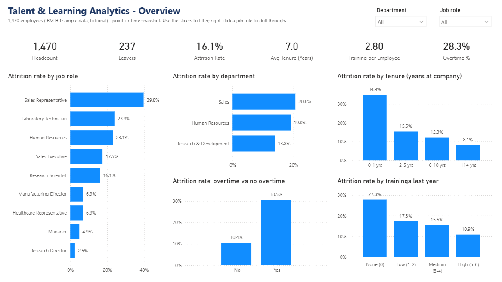

# User Guide - Talent & Learning Analytics Dashboard

For HR, Talent and Learning & Development users. The dashboard covers 1,470 employees (IBM HR sample data, fictional) at one point in time.

## 1. Open the dashboard
- Open `03_PowerBI/Talent_Learning_Dashboard.pbip` in Power BI Desktop (or a `.pbix` copy if you were sent one).
- If the visuals are empty, click **Home -> Refresh**. If the refresh cannot find the files, set **Home -> Transform data (drop-down arrow) -> Edit parameters -> ProjectFolder** to the project folder and refresh again.

## 2. The pages
| Page | Use it to |
|---|---|
| **Overview** | How big is attrition and where is it concentrated? |
| **Insights & Actions** | What should HR do about it? |
| **Attrition Drivers** | Which groups leave most? |
| **Training & Learning** | Who gets trained, and does it relate to attrition? |
| **Satisfaction & Performance** | Do satisfaction and performance ratings relate to attrition? |
| **Job Role Summary** | Which roles need attention first? |
| **Employee Details** | Who exactly is in this group? (drill-through) |
| **Data Quality** | Can I trust the numbers? (self-tests, recalculated on every refresh) |

## 3. Filter, highlight and drill through
- **Slicers:** use the **Department** and **Job role** drop-downs at the top right of each analysis page. Hold **Ctrl** to select several values. To clear a slicer, hover over it and click the eraser icon (**Clear selections**).
- **Cross-filter:** click a bar to filter the other visuals on the same page; click it again to undo.
- **Drill through:** right-click a job role (a bar or a row in the Job Role Summary matrix) -> **Drill through -> Employee Details**. The page shows the employees of that role with their status, tenure, training and income.
- **Back button:** the arrow at the top right of Employee Details returns to the page you came from. In Power BI Desktop, **Ctrl+click** it; in the Power BI service a normal click works.
- **Tooltips:** hover over any bar to see its exact value.

## 4. KPI definitions
| KPI | Definition | Company value |
|---|---|---|
| **Headcount** | Employees in the current selection (leavers included) | 1,470 |
| **Leavers** | Employees who left | 237 |
| **Attrition Rate** | Leavers / Headcount | 16.1% |
| **Attrition vs Company (pts)** | Selected attrition rate minus the company rate; positive = worse than the company | 0.0% (company); +23.6% for Sales Representatives |
| **Avg Tenure (Years)** | Average years at the company | 7.0 |
| **Early Tenure Attrition Rate (0-1 yrs)** | Attrition rate of employees in their first 0-1 years | 34.9% |
| **Training per Employee** | Trainings attended last year / Headcount | 2.80 |
| **% No Training** | Share of employees with no training last year | 3.7% |
| **Overtime %** | Share of employees who work overtime | 28.3% |
| **Overtime Attrition Ratio** | Attrition with overtime / attrition without overtime | 2.9x |
| **% Low Job Satisfaction** | Share of employees rating job satisfaction Low (1 on a 1-4 scale) | 19.7% |
| **Avg Work-Life Balance** | Average rating from 1 (Bad) to 4 (Best) | 2.76 |

All values change with the slicers, except the company baseline used by *Attrition vs Company (pts)*. Full list of measures and their DAX: `03_PowerBI/model/DAX_Measures.md`.

## 5. Read the numbers carefully
- **Associations, not causes.** The data is a snapshot; use the findings to choose pilots, not as proof.
- **Small groups move a lot.** For example, only 54 employees had no training and 83 are Sales Representatives - one person more or less changes their rate noticeably.
- **No dates.** There are no trends over time; every page shows the same moment.
- **Data Quality page:** if any of the 35 checks shows FAIL after a refresh, do not use the numbers until the data is fixed.

## 6. Page layout at a glance
Every analysis page follows the same layout: title and slicers at the top, KPI cards below them, charts underneath - read left to right.

