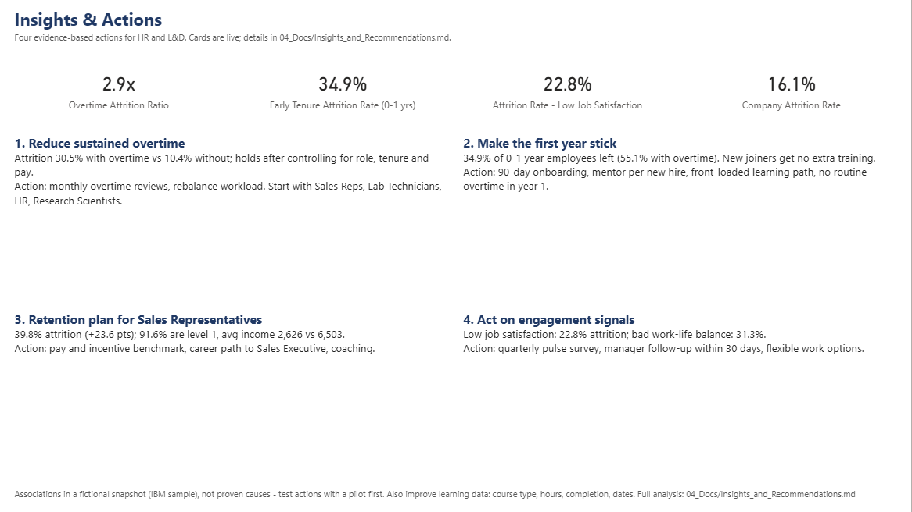
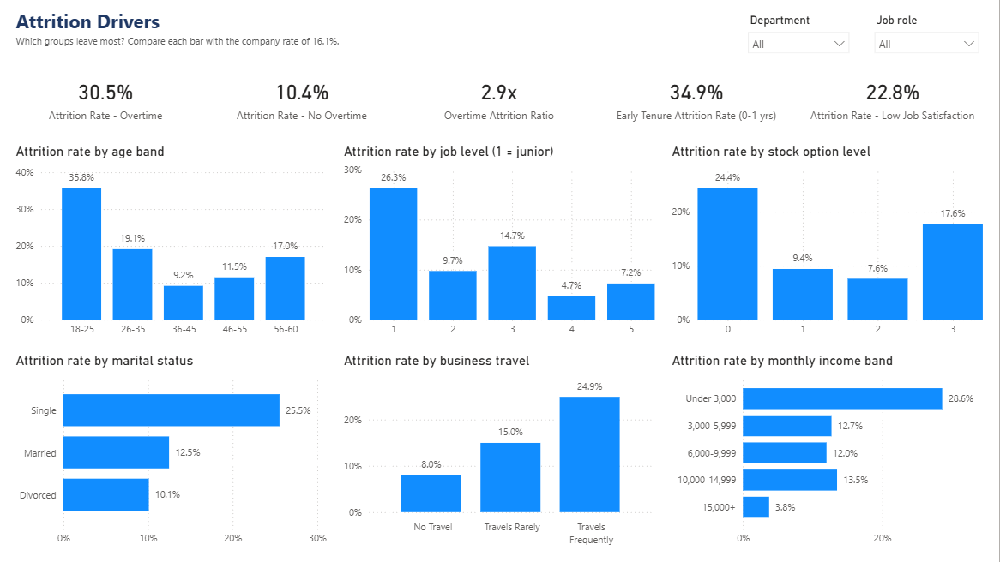
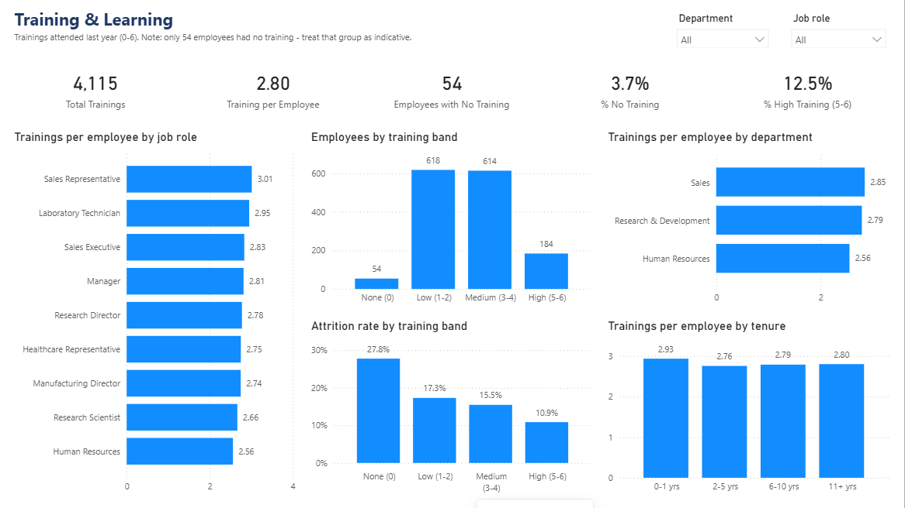
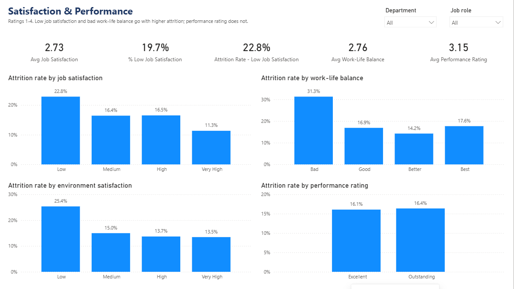
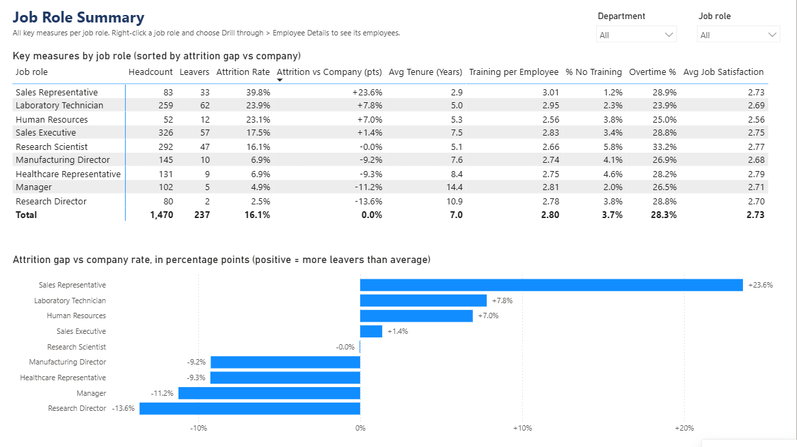
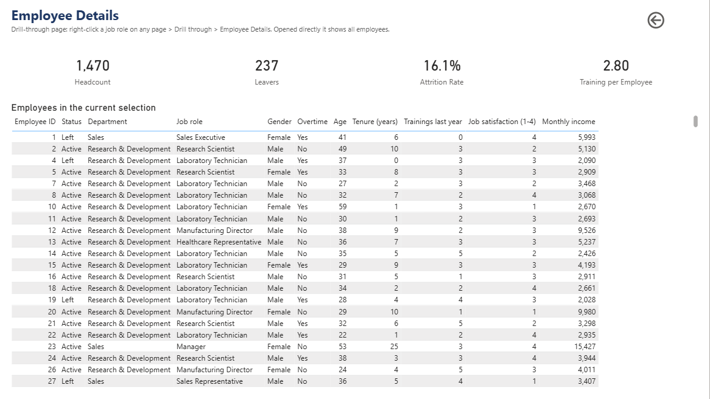
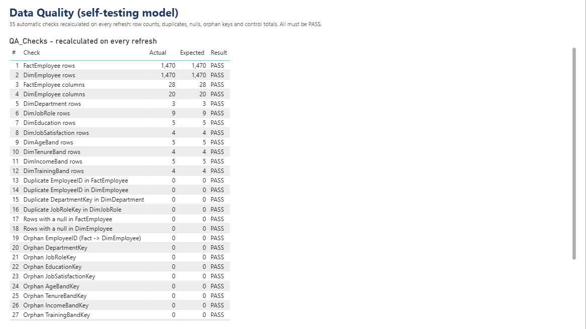
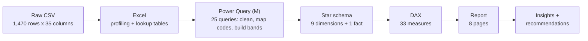
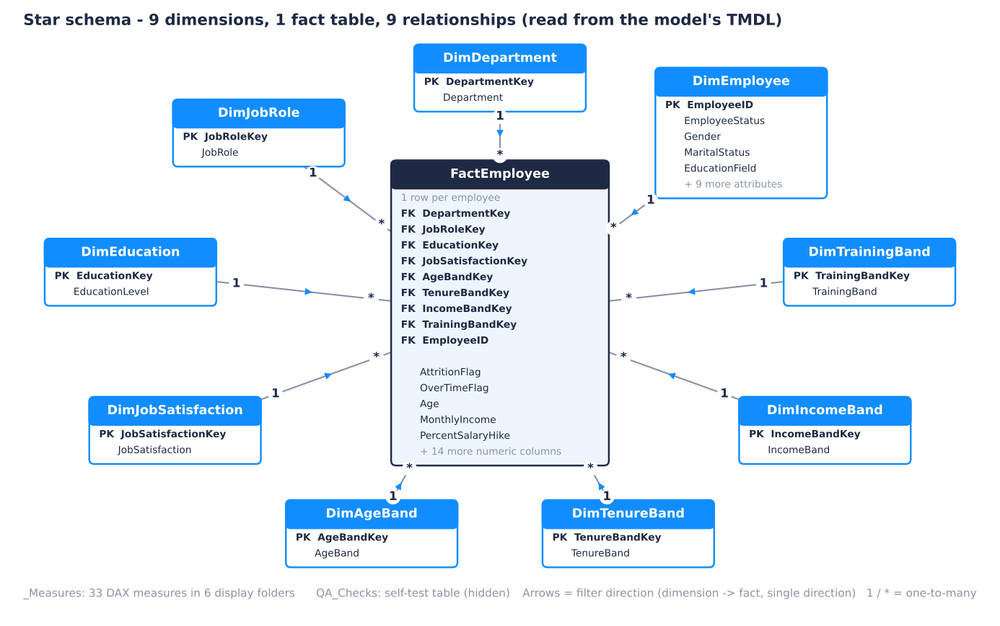

# Talent & Learning Analytics Dashboard (Power BI)

An HR analytics dashboard that tracks **headcount, attrition, training, satisfaction and performance** by department, job role and tenure, finds the main **attrition drivers**, and turns them into recommendations for HR and Learning & Development.

Built with **Power BI, Power Query (M), DAX and Excel** on the public IBM HR Analytics sample (1,470 employees, fictional data). Every step - from the raw CSV to the numbers in the slides - is checked by automated validation against the raw data (498 checks, all passing).


## Key findings

- **16.1% of employees left** (237 of 1,470).
- **Overtime is the strongest driver:** 30.5% attrition with overtime vs 10.4% without (2.9x). It holds within job roles (odds ratio 4.3) and after controlling for tenure, satisfaction, job level, stock options and other factors in a logistic regression (odds ratio 5.0).
- **The first year is the riskiest:** 34.9% of employees in their first 0-1 years left - 55.1% when they also work overtime.
- **Sales Representatives are the hotspot:** 39.8% attrition (+23.6 pts vs the company).
- **Engagement matters:** low job satisfaction 22.8%, bad work-life balance 31.3%.
- **Performance rating does not predict attrition** (16.4% for Outstanding vs 16.1% for everyone else).

Full analysis with confidence intervals, significance tests and a logistic regression: [`04_Docs/Insights_and_Recommendations.md`](04_Docs/Insights_and_Recommendations.md). Five-slide summary: [`05_Presentation/Talent_Learning_Deck.pdf`](05_Presentation/Talent_Learning_Deck.pdf).

> The data is a fictional point-in-time snapshot, so these are associations, not proven causes. The recommendations are framed as pilots to test.

## Dashboard (8 pages, 77 visuals)

| Page | Question it answers |
|---|---|
| **Overview** | How big is attrition and where is it concentrated? |
| **Insights & Actions** | What should HR do about it? |
| **Attrition Drivers** | Which groups leave most? |
| **Training & Learning** | Who gets trained, and does it relate to attrition? |
| **Satisfaction & Performance** | Do satisfaction and performance ratings relate to attrition? |
| **Job Role Summary** | Which roles need attention first? |
| **Employee Details** | Who exactly is in this group? (drill-through) |
| **Data Quality** | Can I trust the numbers? (self-tests, recalculated on every refresh) |

Every analysis page has **Department** and **Job role** slicers. Right-click any job role and choose **Drill through -> Employee Details** to see the people behind a number. See the [User Guide](04_Docs/User_Guide.md).

<table>
<tr>
<td width="50%"><br><b>Overview</b></td>
<td width="50%"><br><b>Insights & Actions</b></td>
</tr>
<tr>
<td width="50%"><br><b>Attrition Drivers</b></td>
<td width="50%"><br><b>Training & Learning</b></td>
</tr>
<tr>
<td width="50%"><br><b>Satisfaction & Performance</b></td>
<td width="50%"><br><b>Job Role Summary</b></td>
</tr>
<tr>
<td width="50%"><br><b>Employee Details</b></td>
<td width="50%"><br><b>Data Quality</b></td>
</tr>
</table>

## How it is built



| Stage | What happens | Where |
|---|---|---|
| Excel | Data profiling (pivot tables, KPI summary) and a lookup workbook that maps codes to labels and defines the bands | `02_Excel_Profiling/`, `01_Data/lookups/` |
| Power Query | 25 M queries: typed import, cleaning, code-to-label mapping, age / tenure / income / training bands, split into dimensions and fact, plus a self-testing QA table | `03_PowerBI/PowerQuery/` |
| Model | Star schema with 9 single-direction one-to-many relationships, surrogate keys, sort-by columns, hidden helper columns | `03_PowerBI/Talent_Learning_Dashboard.SemanticModel/` |
| DAX | 33 measures in 6 display folders (headcount and attrition, tenure, training, overtime, satisfaction, demographics) | `03_PowerBI/model/DAX_Measures.md` |
| Report | 8 pages incl. a drill-through page and a data-quality page | `03_PowerBI/Talent_Learning_Dashboard.Report/` |

The project is saved in **Power BI Project (PBIP) format**: the model is plain-text TMDL and the report is PBIR JSON, so every change can be reviewed line by line in Git. The model and report definitions are generated by scripts (`03_PowerBI/model/build_pbip.py`, `03_PowerBI/report/build_report.py`), so the whole project can be rebuilt from source.

## Data model



- **Why a star schema for one flat file?** Clean slicers, simple DAX, and room to add real HR tables later (courses, hires, exits) as new facts that share these dimensions.
- **Single-direction filters** (dimension -> fact) keep filter paths unambiguous. `DimEmployee` is related many-to-one instead of one-to-one so it does not force two-way filtering.
- **Sort-by columns** put bands and ratings in logical order (Low -> Very High, 0-1 yrs -> 11+ yrs) instead of alphabetical.
- **Self-testing model:** the hidden `QA_Checks` table recalculates 35 checks (row counts, duplicates, nulls, orphan keys, control totals) on every refresh and is shown on the Data Quality page.

Details: [`03_PowerBI/model/Model_Design.md`](03_PowerBI/model/Model_Design.md).

## DAX measures

All 33 measures live in the `_Measures` table. Ratios use `DIVIDE()` (no divide-by-zero errors), segment measures use `KEEPFILTERS()` so they respect filters already on the visual, and only the company baseline uses `REMOVEFILTERS()`.

| Measure | Value (whole company) | Meaning |
|---|---|---|
| `Headcount` | 1,470 | Number of employees in the current filter context (leavers included). |
| `Leavers` | 237 | Employees who left (AttritionFlag = 1). 0 when nobody in the selection left. |
| `Active Employees` | 1,233 | Employees still employed. |
| `Attrition Rate` | 16.1% | Leavers / Headcount. |
| `Retention Rate` | 83.9% | Active Employees / Headcount (= 1 - Attrition Rate). |
| `Company Attrition Rate` | 16.1% | Attrition rate of the whole company, ignoring every filter and slicer. Baseline for comparisons. |
| `Attrition vs Company (pts)` | 0.0% | Selected attrition rate minus company attrition rate, in percentage points. Positive = worse than company. |
| `Avg Tenure (Years)` | 7.0 | Average years at the company. |
| `Median Tenure (Years)` | 5.0 | Median years at the company (robust to very long tenures). |
| `Avg Tenure of Leavers (Years)` | 5.1 | Average years at the company of employees who left. |
| `Early Tenure Attrition Rate (0-1 yrs)` | 34.9% | Attrition rate of employees in their first 0-1 years. Basis for the onboarding recommendation. |
| `Avg Years Since Promotion` | 2.2 | Average years since the last promotion. |
| `Total Trainings` | 4,115 | Total trainings attended last year. |
| `Training per Employee` | 2.80 | Average trainings per employee last year (Total Trainings / Headcount). |
| `Employees with No Training` | 54 | Employees who attended no training last year. |
| `% No Training` | 3.7% | Share of employees with no training last year. |
| `% High Training (5-6)` | 12.5% | Share of employees with 5-6 trainings last year. |
| `Attrition Rate - No Training` | 27.8% | Attrition rate of employees with no training last year (small group - treat as indicative). |
| `Overtime Employees` | 416 | Employees working overtime. 0 when nobody in the selection works overtime. |
| `Overtime %` | 28.3% | Share of employees working overtime. |
| `Attrition Rate - Overtime` | 30.5% | Attrition rate of employees who work overtime. |
| `Attrition Rate - No Overtime` | 10.4% | Attrition rate of employees who do not work overtime. |
| `Overtime Attrition Ratio` | 2.9x | How many times higher attrition is with overtime than without (e.g. 2.9x). |
| `Avg Job Satisfaction` | 2.73 | Average job satisfaction, 1 (Low) to 4 (Very High). |
| `% Low Job Satisfaction` | 19.7% | Share of employees rating job satisfaction 'Low' (1). |
| `Attrition Rate - Low Job Satisfaction` | 22.8% | Attrition rate of employees with 'Low' job satisfaction. |
| `Avg Environment Satisfaction` | 2.72 | Average environment satisfaction, 1 (Low) to 4 (Very High). |
| `Avg Work-Life Balance` | 2.76 | Average work-life balance, 1 (Bad) to 4 (Best). |
| `Avg Job Involvement` | 2.73 | Average job involvement, 1 (Low) to 4 (Very High). |
| `Avg Performance Rating` | 3.15 | Average performance rating (only 3 = Excellent and 4 = Outstanding occur). |
| `Avg Age` | 36.9 | Average employee age. |
| `Avg Monthly Income` | 6,503 | Average monthly income (currency not stated in the source data). |
| `Avg Salary Hike (%)` | 15.2 | Average last salary increase in percent (e.g. 15.2 = 15.2%). |

<details><summary><b>DAX - Headcount & Attrition</b> (7 measures)</summary>

**Headcount**  (format `#,##0`)
```dax
COUNTROWS ( FactEmployee )
```
**Leavers**  (format `#,##0`)
```dax
SUM ( FactEmployee[AttritionFlag] )
```
**Active Employees**  (format `#,##0`)
```dax
[Headcount] - [Leavers]
```
**Attrition Rate**  (format `0.0%`)
```dax
DIVIDE ( [Leavers], [Headcount] )
```
**Retention Rate**  (format `0.0%`)
```dax
DIVIDE ( [Active Employees], [Headcount] )
```
**Company Attrition Rate**  (format `0.0%`)
```dax
CALCULATE ( [Attrition Rate], REMOVEFILTERS () )
```
**Attrition vs Company (pts)**  (format `+0.0%;-0.0%;0.0%`)
```dax
VAR rate = [Attrition Rate]
RETURN
    IF ( NOT ISBLANK ( rate ), rate - [Company Attrition Rate] )
```
</details>

<details><summary><b>DAX - Tenure</b> (5 measures)</summary>

**Avg Tenure (Years)**  (format `0.0`)
```dax
AVERAGE ( FactEmployee[YearsAtCompany] )
```
**Median Tenure (Years)**  (format `0.0`)
```dax
MEDIAN ( FactEmployee[YearsAtCompany] )
```
**Avg Tenure of Leavers (Years)**  (format `0.0`)
```dax
CALCULATE ( [Avg Tenure (Years)], KEEPFILTERS ( FactEmployee[AttritionFlag] = 1 ) )
```
**Early Tenure Attrition Rate (0-1 yrs)**  (format `0.0%`)
```dax
CALCULATE ( [Attrition Rate], KEEPFILTERS ( FactEmployee[YearsAtCompany] <= 1 ) )
```
**Avg Years Since Promotion**  (format `0.0`)
```dax
AVERAGE ( FactEmployee[YearsSinceLastPromotion] )
```
</details>

<details><summary><b>DAX - Training & Learning</b> (6 measures)</summary>

**Total Trainings**  (format `#,##0`)
```dax
SUM ( FactEmployee[TrainingTimesLastYear] )
```
**Training per Employee**  (format `0.00`)
```dax
DIVIDE ( [Total Trainings], [Headcount] )
```
**Employees with No Training**  (format `#,##0`)
```dax
VAR hc = [Headcount]
RETURN
    IF (
        NOT ISBLANK ( hc ),
        COALESCE ( CALCULATE ( [Headcount], KEEPFILTERS ( FactEmployee[TrainingTimesLastYear] = 0 ) ), 0 )
    )
```
**% No Training**  (format `0.0%`)
```dax
DIVIDE ( [Employees with No Training], [Headcount] )
```
**% High Training (5-6)**  (format `0.0%`)
```dax
VAR high =
    CALCULATE ( [Headcount], KEEPFILTERS ( FactEmployee[TrainingTimesLastYear] >= 5 ) )
RETURN
    DIVIDE ( COALESCE ( high, 0 ), [Headcount] )
```
**Attrition Rate - No Training**  (format `0.0%`)
```dax
CALCULATE ( [Attrition Rate], KEEPFILTERS ( FactEmployee[TrainingTimesLastYear] = 0 ) )
```
</details>

<details><summary><b>DAX - Overtime</b> (5 measures)</summary>

**Overtime Employees**  (format `#,##0`)
```dax
SUM ( FactEmployee[OverTimeFlag] )
```
**Overtime %**  (format `0.0%`)
```dax
DIVIDE ( [Overtime Employees], [Headcount] )
```
**Attrition Rate - Overtime**  (format `0.0%`)
```dax
CALCULATE ( [Attrition Rate], KEEPFILTERS ( FactEmployee[OverTimeFlag] = 1 ) )
```
**Attrition Rate - No Overtime**  (format `0.0%`)
```dax
CALCULATE ( [Attrition Rate], KEEPFILTERS ( FactEmployee[OverTimeFlag] = 0 ) )
```
**Overtime Attrition Ratio**  (format `0.0"x"`)
```dax
DIVIDE ( [Attrition Rate - Overtime], [Attrition Rate - No Overtime] )
```
</details>

<details><summary><b>DAX - Satisfaction & Performance</b> (7 measures)</summary>

**Avg Job Satisfaction**  (format `0.00`)
```dax
AVERAGE ( FactEmployee[JobSatisfactionScore] )
```
**% Low Job Satisfaction**  (format `0.0%`)
```dax
VAR low =
    CALCULATE ( [Headcount], KEEPFILTERS ( FactEmployee[JobSatisfactionScore] = 1 ) )
RETURN
    DIVIDE ( COALESCE ( low, 0 ), [Headcount] )
```
**Attrition Rate - Low Job Satisfaction**  (format `0.0%`)
```dax
CALCULATE ( [Attrition Rate], KEEPFILTERS ( FactEmployee[JobSatisfactionScore] = 1 ) )
```
**Avg Environment Satisfaction**  (format `0.00`)
```dax
AVERAGE ( FactEmployee[EnvironmentSatisfactionScore] )
```
**Avg Work-Life Balance**  (format `0.00`)
```dax
AVERAGE ( FactEmployee[WorkLifeBalanceScore] )
```
**Avg Job Involvement**  (format `0.00`)
```dax
AVERAGE ( FactEmployee[JobInvolvementScore] )
```
**Avg Performance Rating**  (format `0.00`)
```dax
AVERAGE ( FactEmployee[PerformanceRatingScore] )
```
</details>

<details><summary><b>DAX - Demographics & Pay</b> (3 measures)</summary>

**Avg Age**  (format `0.0`)
```dax
AVERAGE ( FactEmployee[Age] )
```
**Avg Monthly Income**  (format `#,##0`)
```dax
AVERAGE ( FactEmployee[MonthlyIncome] )
```
**Avg Salary Hike (%)**  (format `0.0`)
```dax
AVERAGE ( FactEmployee[PercentSalaryHike] )
```
</details>

Design notes and likely interview questions: [`03_PowerBI/model/DAX_Measures.md`](03_PowerBI/model/DAX_Measures.md).

## How to open it

**You need:** Windows and [Power BI Desktop](https://www.microsoft.com/power-platform/products/power-bi/desktop) (free).

1. Download the repository (**Code -> Download ZIP**, then unzip) or `git clone` it.
2. Open `03_PowerBI/Talent_Learning_Dashboard.pbip` in Power BI Desktop. It opens without data, because the data cache is not stored in Git.
3. Point the project at your copy: **Home -> Transform data (drop-down arrow) -> Edit parameters -> `ProjectFolder`** = the folder you unzipped, ending with a backslash (for example `C:\Users\you\Downloads\Talent-Learning-Dashboard\`). Click OK.
4. Click **Home -> Refresh**. It loads all employees and recalculates the QA checks (see the Data Quality page - every row should say PASS).
5. Optional: **File -> Save as -> Power BI file (.pbix)** for a single file you can share.

No Power BI? Look at the screenshots above, the [dashboard preview PDF](04_Docs/Dashboard_Preview.pdf), or the [deck](05_Presentation/Talent_Learning_Deck.pdf).

## Validation

Every step was validated against the raw CSV with independent Python checks, and the Power BI checks were run inside Power BI Desktop (refresh, DAX queries, opening every page).

| Step | What is checked | Result |
|---|---|---|
| 1 | Data: row and column counts, unique employee IDs, no missing values, valid categories and value ranges, logical consistency | [36/36 passed](01_Data/validation_report_step1.txt) |
| 2 | Excel workbooks: lookups, KPI summary, profiles, data dictionary and key findings recalculated and compared with pandas | [137/137 passed](02_Excel_Profiling/validation_report_step2.txt) |
| 3 | Power Query: all queries run in the real Power Query engine; every output table compared cell by cell with an independent Python mirror | [126/126 passed](03_PowerBI/validation/validation_report_step3.txt) |
| 4 | Star schema: relationships, keys, cardinality, filter direction; refresh and DAX tests in Power BI Desktop | [68/68 passed](03_PowerBI/validation/validation_report_step4.txt) |
| 5 | DAX measures: parsed by Microsoft's TMDL serializer, all Ready in Power BI, Excel KPIs reproduced, values vs pandas incl. edge cases | [60/60 passed](03_PowerBI/validation/validation_report_step5.txt) |
| 6 | Report: Microsoft's official JSON schemas, field references, layout, every displayed value vs the raw CSV, every page opened in Power BI | [43/43 passed](03_PowerBI/validation/validation_report_step6.txt) |
| 7 | Insights: statistics recomputed independently, every number reconciled with Power BI, no hand-typed numbers | [28/28 passed](04_Docs/analysis/validation_report_step7.txt) |

The Step 7 validator was also tested with deliberately planted errors (18/18 caught). This documentation is checked by `04_Docs/build/validate_step8.py` (every number traced to its source, every link and file reference exists, the DAX above equals the model).

To re-run the offline checks: `pip install pandas openpyxl jsonschema statsmodels scikit-learn matplotlib`, then run the `validate_*.py` scripts from the project root (each script's header shows its arguments). The PowerShell checks need Power BI Desktop open with the project.

## Repository structure

```
.
├── README.md
├── System Design.md                     architecture and step-by-step plan
├── 01_Data/                             raw CSV, lookup workbook, Step 1 validation
├── 02_Excel_Profiling/                  Excel data profiling + Step 2 validation
├── 03_PowerBI/
│   ├── Talent_Learning_Dashboard.pbip   <- open this in Power BI Desktop
│   ├── Talent_Learning_Dashboard.SemanticModel/   model (TMDL)
│   ├── Talent_Learning_Dashboard.Report/          report (PBIR)
│   ├── PowerQuery/                      the 25 M queries + setup guide
│   ├── model/                           model + measure generators, Model_Design.md, DAX_Measures.md
│   ├── report/                          report generator + Report_Guide.md
│   └── validation/                      validators and reports for Steps 3-6
├── 04_Docs/                             insights, user guide, dashboard preview PDF, doc generators
├── 05_Presentation/                     5-slide deck (PPTX + PDF)
└── screenshots/                         page screenshots + star schema
```

## Data source and licence

- **Dataset:** IBM HR Analytics Employee Attrition & Performance - a fictional dataset created by IBM data scientists, published on [Kaggle](https://www.kaggle.com/datasets/pavansubhasht/ibm-hr-analytics-attrition-dataset). IBM lists it under the Open Database License (ODbL) for the database and the Database Contents License (DbCL) for its contents ([source](https://github.com/IBM/employee-attrition-aif360)). The CSV is included unchanged in `01_Data/raw/`.
- **Code and documentation** in this repository: MIT License (see `LICENSE`).

## Limitations

- Fictional sample data: re-run the pipeline on real HR data before drawing real conclusions.
- One snapshot with no dates: no trends, and no before/after measurement of any action.
- Training is only recorded as a count of trainings last year (no course type, hours or completion).

---

Author: **Kapil Sandhu** - [GitHub](https://github.com/Kapil-Sandhu)
